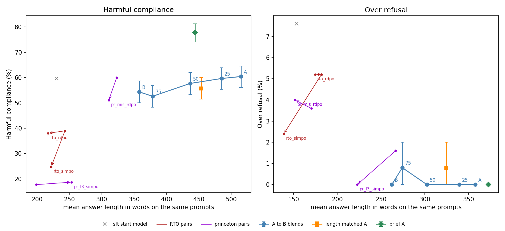

# Does length-bias suppression make DPO models less safe? Initial effect study

**Short answer: no.** The length-penalised model is slightly *safer* (about 6 points less harmful compliance). The difference is real across three scorers, but we cannot separate it from the fact that its answers are shorter. We therefore do not think it is worth a spectral analysis of this pair yet.

## Setup

- **Main pair:** Salesforce LLaMA-3-8B iterative DPO (**A**, no length penalty) vs the same recipe with a length penalty (**B**, Concise-R). Both start from the same SFT model. We also test weight blends of A and B at 25 / 50 / 75 % B.
- **Prompts:** 513 harmful (HarmBench standard + StrongREJECT), 250 harmless (XSTest safe), 300 AlpacaEval for length. Greedy decoding, up to 1024 tokens, 1,263 prompts per model.
- **Scoring:** HarmBench classifier (main), WildGuard and StrongREJECT as checks.
- **Length controls:** A sampled 4× with the answer closest in length to B's kept; A prompted "keep your answer under 326 words"; a logistic model with log(words).
- **Second and third checks:** RTO-RL DPO vs R-DPO / SimPO (same SFT start), and princeton Mistral DPO vs R-DPO and Llama-3-Instruct DPO vs SimPO.
- **Statistics:** paired bootstrap 95 % intervals over prompts, McNemar tests. The evidence rules were fixed before the full run.

## Results

| Evidence point (fixed in advance) | Result | Holds? |
|---|---|---|
| 1. B shorter than A | 31 % fewer words [29, 33] | yes |
| 2. Safety differs, beyond length | B − A compliance **−6.0 points [−9.9, −2.1]** (60.4 → 54.4 %; WildGuard −6.6, StrongREJECT −3.2). But B − length-matched A is −1.4 [−5.5, +2.7], and B's coefficient reverses to +0.75 [+0.47, +1.03] once log length is included | **no** |
| 2. Over-refusal | A and B refuse 0 of 250 harmless prompts | untestable |
| 3. Follows the blend share | slope −7.6 points per A→B [−11.5, −3.7]; rates 60.4, 59.6, 57.7, 52.6, 54.4 (not monotone) | yes, descriptively |

**Second and third checks (harmful compliance, shorter model minus its DPO sibling):**

| Pair | Difference | Notes |
|---|---|---|
| RTO R-DPO | −1.0 [−3.7, +1.8] | only 5 % shorter |
| RTO SimPO | −14.2 [−18.7, −9.7] | +0.6 [−4.1, +5.5] under WildGuard: it wraps compliant answers in disclaimers |
| princeton Mistral R-DPO | −9.0 [−12.9, −5.1] | WildGuard agrees (−5.3) |
| princeton Llama-3 SimPO | +1.0 [−1.6, +3.5] | longer than DPO on harmful prompts |

None of the pairs shows a significant safety *loss*.

**An unexpected result:** the brevity-prompted A was only 9 % shorter, yet its harmful compliance rose by **+17.3 points [+13.5, +21.2]**. So training for brevity makes the model slightly safer, while asking for brevity makes it much less safe.

## Limitations

- **Scorers not validated by hand labels** (planned 100 labels, not done). Only the agreement of three different scorers supports the B − A result.
- **Both length controls are imperfect.** Matching on length closes only 39 % of the length gap. Refusals are short, so the matched A sample is often a refusal (over-control). The regression adjusts for length, which is itself a consequence of complying.
- **A is not a strongly safety-tuned model** (60 % compliance), so this pair tests whether shortening *adds* refusals.
- The models ran in fp16 on T4 GPUs; there is one greedy sample per prompt and one main pair.

## Proposed next step

1. **Close the main question as a careful negative result.** First, as a cheap check (about 1 GPU hour), cut A's answers to B's length and re-score them. This tells us directly whether shorter text alone scores as less harmful.
2. **Optional new direction:** test whether brevity *instructions* raise harmful compliance across our 10 models, using a neutral instruction of equal length as the control. This would be exploratory, since the effect was found here as a control, not as a planned hypothesis. Spectral and refusal-direction analysis would fit this question better than the A/B difference.
